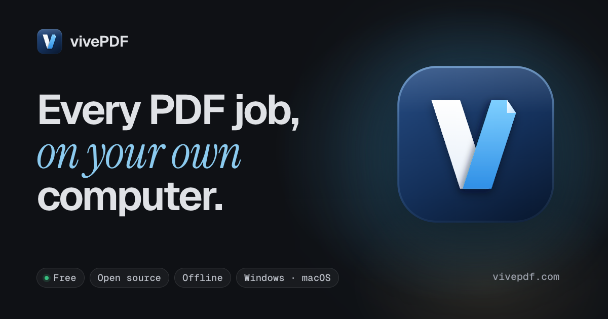

<div align="center">


# vivePDF

**Every PDF job, on your own computer.**

An open-source, offline PDF studio for Windows and macOS. View, edit, convert, OCR, sign and present PDFs; your files never leave your machine.

**English** · [Türkçe](README.tr.md)

[Website](https://vivepdf.com/en/) · [Documentation](https://vivepdf.com/en/docs/) · [Download](https://github.com/mtvrkan/vivePDF/releases/latest) · [Release notes](https://vivepdf.com/en/docs/release-notes/) · [Discussions](https://github.com/mtvrkan/vivePDF/discussions)

[](https://github.com/mtvrkan/vivePDF/releases/latest)
[](LICENSE)




</div>

## Why vivePDF

- **Offline by design.** Every job runs on a local engine. No account, no telemetry, no uploads; an offline mode switches off the few features that need the internet.
- **One app for the whole job.** Reading, editing, organising pages, converting, OCR, signing, forms, comparing and presenting live in one window instead of a dozen web tools.
- **Free and open.** AGPL-3.0, with the source for every build. The app updates itself in small, signed packages and never installs anything without asking.

## Features

- **Viewer** — tabs and tab groups across windows, search, outline, thumbnails, layers, comments and highlights; large files (a 244 MB scan) open in pieces instead of loading whole.
- **Edit** — text, images, shapes, tables, charts, LaTeX formulas, function graphs, molecules, flowcharts, questions and answer keys, all saved as real PDF content.
- **Pages** — reorder, rotate, delete, duplicate, insert blank or lined paper or pages from other PDFs, split, merge, page labels, duplex printing order.
- **Convert** — PDF to Word, Excel, PowerPoint, Markdown and images; Office files, e-books, e-mails, images and web pages to PDF; PDF/A archiving and print preflight. Word, Excel and PowerPoint files open straight from **Open With** in Finder and Explorer.
- **OCR and scans** — searchable PDFs from scans in many languages, straightening and clean-up, scanning straight from a scanner.
- **Security** — passwords, permissions, redaction, metadata clean-up, digital signatures and certificate checks.
- **Forms and codes** — fill and build forms, QR and barcodes, optical answer sheets that grade themselves.
- **Compare, compress, batch** — side-by-side, text and visual compare, compression, batch runs, watched folders and bulk rename.
- **Studio** — a design and document editor with templates for CVs, exam papers, certificates, brochures, invoices and business cards; documents with sources, citations, footnotes and columns.
- **Presenter view** — speaker notes, the next page and a timer on your screen, the page full screen on the projector, and black and white boards to draw on.
- **Accessibility and languages** — tagged-PDF checks and alt text; the interface comes in 8 languages (Turkish, English, German, French, Spanish, Italian, Brazilian Portuguese and right-to-left Arabic).

## Install

**Windows 10 or 11 (64-bit):** download `vivePDF_<version>_x64-setup.exe` from [Releases](https://github.com/mtvrkan/vivePDF/releases/latest) and run it. The installer carries no code signature, so Windows SmartScreen shows "Windows protected your PC" the first time: click **More info** → **Run anyway**. Office conversions use LibreOffice, which comes with the installer and is set up without internet on first start (about 900 MB on disk; **Settings › Tools** can remove or reinstall it).

**macOS 14 Sonoma or later (Apple silicon):** download `vivePDF_<version>_aarch64.dmg` from [Releases](https://github.com/mtvrkan/vivePDF/releases/latest), open it and drag vivePDF to Applications. The app is not notarised by Apple, so Gatekeeper blocks the first start: open **System Settings › Privacy & Security** and click **Open Anyway** next to the vivePDF message, or run `xattr -dr com.apple.quarantine /Applications/vivePDF.app`. Office conversions use a LibreOffice installed in Applications; without one, vivePDF offers to download and set it up on the first Office file; scanning uses SANE (`brew install sane-backends`).

**Linux:** build from source (below).

Updates arrive from inside the app (**Settings › Updates**). Step-by-step guides: [installation](https://vivepdf.com/en/docs/installation/), [troubleshooting](https://vivepdf.com/en/docs/troubleshooting/), [FAQ](https://vivepdf.com/en/docs/faq/).

## Development

Stack: Tauri 2 (Rust) shell · React 19 + TypeScript + Tailwind v4 UI with the EmbedPDF viewer · Python engine on PyMuPDF (+ pdf2docx, OCRmyPDF, pyHanko, Tesseract) running as a sidecar.

Prerequisites: Node 22 + pnpm, Rust (stable) + platform build tools, Python 3.12+ + uv.

```
cd apps/desktop && pnpm install
cd ../../sidecar && uv sync
cd ../apps/desktop && pnpm tauri dev
```

Tests: `pnpm test` / `pnpm typecheck` / `pnpm lint` (UI) · `uv run pytest` (engine) · `cargo test` (Rust) · `pnpm e2e` (the real app on Windows, see [docs/TESTING.md](docs/TESTING.md)). Building and publishing a release: [docs/RELEASING.md](docs/RELEASING.md). A longer walkthrough is in [Build from source](https://vivepdf.com/en/docs/build-from-source/).

## Website

The site at https://vivepdf.com lives in `apps/site` (Astro, Turkish at `/`, English at `/en/`, with the documentation under `/dokumantasyon/` and `/en/docs/`). `pnpm site:dev` runs it locally and `pnpm site:build` builds it with the search index. The tool list, shortcuts and release notes on the site come from `apps/site/src/data/app-data.json`, which `apps/desktop/src/app/siteData.test.ts` keeps in step with the app (`UPDATE_SITE_DATA=1 pnpm vitest run src/app/siteData.test.ts` in `apps/desktop` rewrites it). `scripts/deploy-site.sh` builds the site into the `gh-pages` branch for GitHub Pages; add `--push` to publish it.

## Contributing and support

Bug reports go to [Issues](https://github.com/mtvrkan/vivePDF/issues), questions and ideas to [Discussions](https://github.com/mtvrkan/vivePDF/discussions); **Help › Report a bug** in the app opens a prefilled issue and shows exactly what it includes before anything leaves your computer. Pull requests are welcome, see [CONTRIBUTING.md](CONTRIBUTING.md); the community rules are in [CODE_OF_CONDUCT.md](CODE_OF_CONDUCT.md). Security problems: please follow [SECURITY.md](SECURITY.md) instead of opening a public issue.

## Code signing policy

Signing of the Windows releases is being set up through SignPath Foundation: free code signing provided by [SignPath.io](https://about.signpath.io/), certificate by [SignPath Foundation](https://signpath.org/). Signed installers are built from this repository on GitHub Actions and every release is approved by hand. Team roles and the privacy statement: [Code signing policy](https://vivepdf.com/en/docs/license/#code-signing-policy).

## License

AGPL-3.0 — see [LICENSE](LICENSE). Distributing builds of vivePDF requires offering the corresponding source under the same license. Third-party notices are in [THIRD_PARTY_NOTICES.md](THIRD_PARTY_NOTICES.md).
