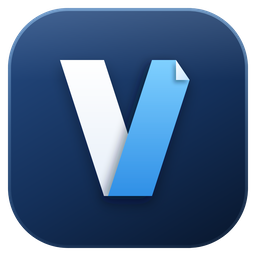
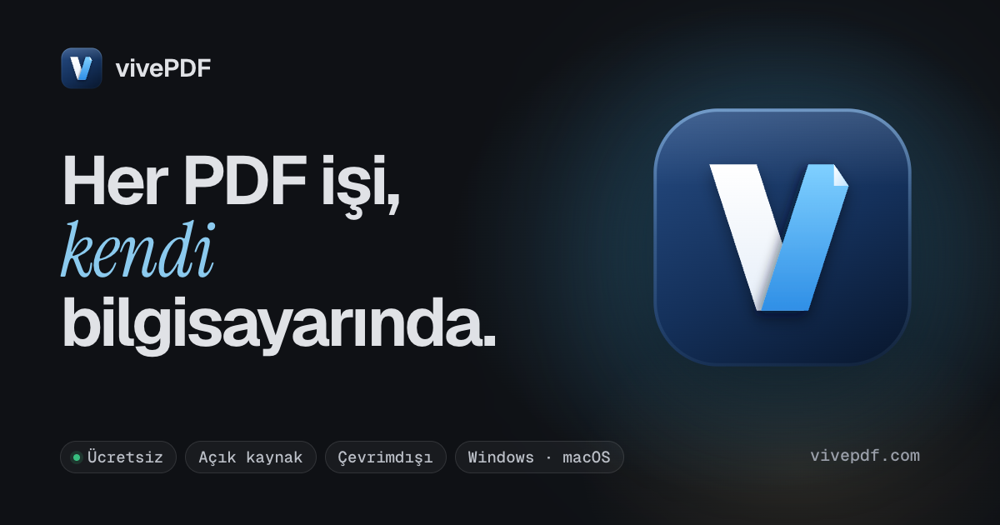

<div align="center">



# vivePDF

**Her PDF işi, kendi bilgisayarında.**

Windows ve macOS için açık kaynak, internetsiz çalışan bir PDF stüdyosu. PDF'leri görüntüle, düzenle, dönüştür, OCR'la, imzala ve sun; dosyaların bilgisayarından hiç çıkmaz.

[English](README.md) · **Türkçe**

[Web sitesi](https://vivepdf.com/tr/) · [Dokümantasyon](https://vivepdf.com/dokumantasyon/) · [İndir](https://github.com/mtvrkan/vivePDF/releases/latest) · [Sürüm notları](https://vivepdf.com/dokumantasyon/surum-notlari/) · [Tartışmalar](https://github.com/mtvrkan/vivePDF/discussions)

[](https://github.com/mtvrkan/vivePDF/releases/latest)
[](LICENSE)




</div>

## Neden vivePDF

- **Baştan internetsiz.** Her iş bilgisayarındaki yerel motorda yapılır. Hesap yok, kullanım verisi toplanmaz, hiçbir şey yüklenmez; çevrimdışı mod, internet isteyen birkaç özelliği de tek anahtarla kapatır.
- **Bütün iş tek uygulamada.** Okuma, düzenleme, sayfa düzenleme, dönüştürme, OCR, imza, formlar, karşılaştırma ve sunum, bir düzine web aracı yerine tek pencerede.
- **Ücretsiz ve açık.** AGPL-3.0 lisanslı, her sürümün kaynak kodu açık. Uygulama kendini küçük, imzalı paketlerle günceller ve sormadan hiçbir şey kurmaz.

## Özellikler

- **Görüntüleyici:** pencereler arasında taşınabilen sekmeler ve sekme grupları, arama, içindekiler, küçük resimler, katmanlar, yorumlar ve vurgular; büyük dosyalar (244 MB'lık bir tarama) tümüyle yüklenmek yerine parça parça açılır.
- **Düzenleme:** metin, resim, şekil, tablo, grafik, LaTeX formülü, fonksiyon grafiği, molekül, akış şeması, soru ve cevap anahtarı; hepsi gerçek PDF içeriği olarak kaydedilir.
- **Sayfalar:** sıralama, döndürme, silme, çoğaltma, boş ya da çizgili sayfa veya başka PDF'lerden sayfa ekleme, bölme, birleştirme, sayfa etiketleri, çift taraflı baskı sırası.
- **Dönüştürme:** PDF'ten Word, Excel, PowerPoint, Markdown ve resme; Office dosyaları, e-kitaplar, e-postalar, resimler ve web sayfalarından PDF'e; PDF/A arşivleme ve baskı öncesi denetim. Word, Excel ve PowerPoint dosyaları Finder ve Explorer'daki **Birlikte Aç** menüsünden doğrudan açılır.
- **OCR ve tarama:** taramalardan birçok dilde aranabilir PDF, eğrilik düzeltme ve temizleme, doğrudan tarayıcıdan tarama.
- **Güvenlik:** parolalar, izinler, karartma, üst veri temizliği, dijital imzalar ve sertifika denetimi.
- **Formlar ve kodlar:** form doldurma ve oluşturma, QR ve barkodlar, kendini puanlayan optik cevap kâğıtları.
- **Karşılaştırma, sıkıştırma, toplu iş:** yan yana, metin ve görsel karşılaştırma, sıkıştırma, toplu çalıştırma, izlenen klasörler ve toplu yeniden adlandırma.
- **Stüdyo:** özgeçmiş, sınav kâğıdı, sertifika, broşür, fatura ve kartvizit şablonlarıyla bir tasarım ve belge düzenleyici; kaynakça, atıf, dipnot ve sütunlu belgeler.
- **Sunucu görünümü:** konuşmacı notları, sonraki sayfa ve süreölçer senin ekranında, sayfa projeksiyonda tam ekran; üzerine çizim yapılabilen siyah ve beyaz tahtalar.
- **Erişilebilirlik ve diller:** etiketli PDF denetimleri ve alternatif metin; arayüz 8 dilde (Türkçe, İngilizce, Almanca, Fransızca, İspanyolca, İtalyanca, Brezilya Portekizcesi ve sağdan sola Arapça).

## Kurulum

**Windows 10 veya 11 (64 bit):** [Sürümler](https://github.com/mtvrkan/vivePDF/releases/latest) sayfasından `vivePDF_<sürüm>_x64-setup.exe` dosyasını indirip çalıştır. Kurulum dosyasında henüz kod imzası olmadığı için Windows SmartScreen ilk seferde "Windows bilgisayarınızı korudu" der: **Ek bilgi** → **Yine de çalıştır**'a tıkla. Office dönüştürmeleri LibreOffice ile yapılır; LibreOffice kurulumla birlikte gelir ve ilk açılışta internetsiz kurulur (diskte yaklaşık 900 MB; **Ayarlar › Araçlar**'dan kaldırılıp yeniden kurulabilir).

**macOS 14 Sonoma veya sonrası (Apple silicon):** [Sürümler](https://github.com/mtvrkan/vivePDF/releases/latest) sayfasından `vivePDF_<sürüm>_aarch64.dmg` dosyasını indir, aç ve vivePDF'i Uygulamalar klasörüne sürükle. Uygulama henüz Apple tarafından onaylanmadığı (notarize edilmediği) için Gatekeeper ilk açılışı engeller: **Sistem Ayarları › Gizlilik ve Güvenlik**'i aç ve vivePDF uyarısının yanındaki **Yine de Aç**'a tıkla ya da `xattr -dr com.apple.quarantine /Applications/vivePDF.app` komutunu çalıştır. Office dönüştürmeleri Uygulamalar'daki LibreOffice'i kullanır; yoksa vivePDF ilk Office dosyasında indirip kurmayı önerir. Tarama için SANE gerekir (`brew install sane-backends`).

**Linux:** kaynaktan derle (aşağıda).

Güncellemeler uygulamanın içinden gelir (**Ayarlar › Güncellemeler**). Adım adım rehberler: [kurulum](https://vivepdf.com/dokumantasyon/kurulum/), [sorun giderme](https://vivepdf.com/dokumantasyon/sorun-giderme/), [SSS](https://vivepdf.com/dokumantasyon/sss/).

## Geliştirme

Yapı: Tauri 2 (Rust) kabuk · React 19 + TypeScript + Tailwind v4 arayüz, EmbedPDF görüntüleyiciyle · PyMuPDF üzerine (pdf2docx, OCRmyPDF, pyHanko, Tesseract ile) Python motoru, yan süreç olarak çalışır.

Gerekenler: Node 22 + pnpm, Rust (stable) + platform derleme araçları, Python 3.12+ + uv.

```
cd apps/desktop && pnpm install
cd ../../sidecar && uv sync
cd ../apps/desktop && pnpm tauri dev
```

Testler: `pnpm test` / `pnpm typecheck` / `pnpm lint` (arayüz) · `uv run pytest` (motor) · `cargo test` (Rust) · `pnpm e2e` (Windows'ta gerçek uygulama, bkz. [docs/TESTING.md](docs/TESTING.md)). Sürüm derleme ve yayınlama: [docs/RELEASING.md](docs/RELEASING.md). Daha ayrıntılı anlatım: [Kaynaktan derleme](https://vivepdf.com/dokumantasyon/kaynaktan-derleme/).

## Web sitesi

https://vivepdf.com adresindeki site `apps/site` içinde (Astro; İngilizce ana sayfa `/`, Türkçe ana sayfa `/tr/`, dokümantasyon `/en/docs/` ve `/dokumantasyon/` altında). Ayrıntılar [İngilizce README](README.md#website)'de.

## Katkı ve destek

Hata bildirimleri [Issues](https://github.com/mtvrkan/vivePDF/issues)'a, sorular ve fikirler [Tartışmalar](https://github.com/mtvrkan/vivePDF/discussions)'a. Uygulamadaki **Yardım › Hata bildir**, önceden doldurulmuş bir bildirim açar ve bilgisayarından herhangi bir şey çıkmadan önce neler gönderileceğini tek tek gösterir. Pull request'ler memnuniyetle karşılanır, bkz. [CONTRIBUTING.md](CONTRIBUTING.md); topluluk kuralları [CODE_OF_CONDUCT.md](CODE_OF_CONDUCT.md)'de. Güvenlik sorunlarını herkese açık bildirim yerine [SECURITY.md](SECURITY.md)'deki yoldan ilet.

## Kod imzalama politikası

Windows sürümlerinin imzalanması SignPath Foundation ile kuruluyor: ücretsiz kod imzalama [SignPath.io](https://about.signpath.io/), sertifika [SignPath Foundation](https://signpath.org/) tarafından sağlanır. İmzalı kurulum dosyaları bu depodan GitHub Actions'ta derlenir ve her sürüm elle onaylanır. Ekip rolleri ve gizlilik açıklaması: [Kod imzalama politikası](https://vivepdf.com/dokumantasyon/lisans/#kod-imzalama-politikası).

## Lisans

AGPL-3.0, bkz. [LICENSE](LICENSE). vivePDF'in derlenmiş sürümlerini dağıtan, karşılık gelen kaynak kodu aynı lisansla sunmak zorundadır. Üçüncü taraf bildirimleri [THIRD_PARTY_NOTICES.md](THIRD_PARTY_NOTICES.md)'de.
